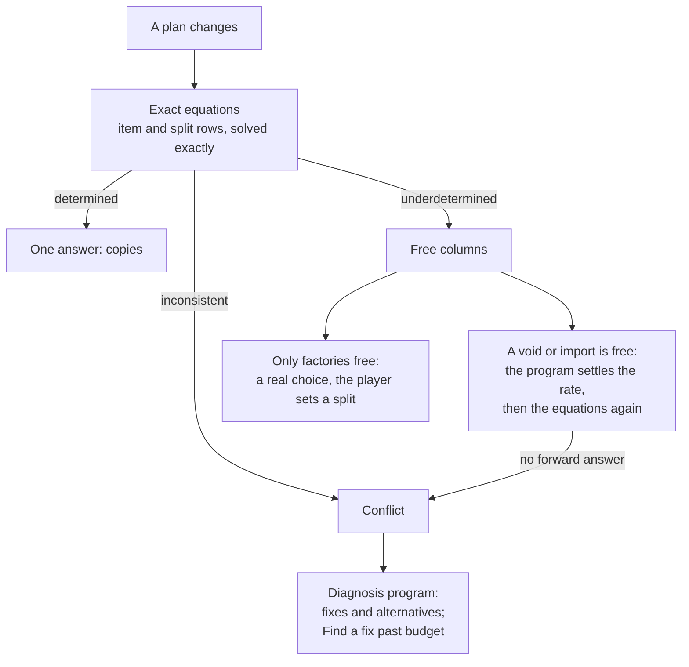

# Stoich's solver: how it balances a plan, and why

Stoich's solver uses two engines. Exact linear equations handle everything that must
balance to the item. A small linear program handles everything that involves a surplus.
Equations answer "how many copies are needed" when the plan is determined. The linear
program answers "what is left over, and where should it go", which equations cannot express.

## Overview

The solver answers three questions:

1. **Factory balance.** Given a factory's recipe lines, its anchors and its splits, how many
   machines does each line need? Exact equations (`scripts/solver.lua`).
2. **Plan balance.** Given every factory's net flow per copy and the sinks' rates, how many
   copies of each factory does the plan need, and at what rate does each void and import
   run? Exact equations for the copies; the linear program settles the void and import
   rates (section "Surplus").
3. **What closes a plan that can't balance.** Which items, voided or imported, would make
   the plan balance with every factory running forwards? The linear program
   (`scripts/lp.lua`, `plan_lp.diagnose`).

The split between the engines follows one fact: production is a set of equalities
(made = used), but a surplus is an inequality (made ≥ used, the rest voided). Where the
plan is determined, equations are exact, fast and easy to explain. Where a factory with
several outputs must run for its most-needed output, the result is a maximum over its
needs, and only an inequality model can say which output binds.

Settling and diagnosis are the linear program; everything else is exact equations, and a
real choice between factories always goes back to the player.

## The model

Everything the solver sees is a **unit** with a **flow**: a map from item key to rate per
unit (per machine in a factory, per copy in the plan). Positive means made, negative means
used. The solver never looks at recipes, machines or modules. Those become flows before the
solver runs (`scripts/scanner.lua`, `scripts/modules.lua`).

| Thing | In the factory balance | In the plan balance | Notes |
| --- | --- | --- | --- |
| Recipe line | a unit, one machine's flow | — | its count is solved |
| Factory | — | a unit, the factory's net flow per copy | its copies are solved; the copies built are compared after |
| Anchor | a line's count fixed | the sinks: their count fixed at their scale | the right-hand side of the equations |
| External item | not balanced inside (crosses the factory's edge) | — | marked by the player |
| Split | shares between the lines that make an item | shares between the factories that make an item | one equation per share; "match usage" recomputes the shares from copies built |
| Sink | — | a unit at fixed count, flow = minus its rates | what the plan is for |
| Void / import row | — | a unit of flow −1 / +1 of one item | its rate is free; the linear program settles it |

**Item keys.** `item/iron-plate`, `fluid/water`, `custom/<label>`. A quality tier above
normal is its own item: `item/iron-plate|rare`. Fluids never carry a tier. To the solver a
tier is just another item, so quality needs no special case in the maths. Grouping by base
item happens only in what is shown (problem rows, statistics) and in void or import rows
with a quality condition (`>=rare`), which expand to the tiers the plan has.

**Closed plan.** Every item in the plan balances: made = used, except what the plan's voids
and imports take. There are no plan-wide externals. Something the plan makes but doesn't
use must go to a sink or a void.

## Exact equations: factory and plan balance

Both balances are the same linear system, solved exactly by Gaussian elimination to reduced
row echelon form (`scripts/linalg.lua`). The unknowns are the free units' counts; anchored
units move to the right-hand side.

- **One equation per balanced item:** the sum over units of count × flow = 0. External items
  have none.
- **One equation per split share:** for a split over lines P with shares s, each line but the
  last makes sᵣ of what P make together.
- **The result is read from the echelon form:**
    - an inconsistent row (0 = non-zero) is a **conflict**, named by the items whose equations
      it combines; an item nothing makes or nothing uses is named first;
    - a free column is a **choice** the player hasn't made: offered as a split on the item with
      the fewest producers (lower quality tier first), or as an anchor when no item can decide it;
    - a negative count, once nothing else is wrong, is a factory or line **running backwards**.

| Status | Means | Shown as |
| --- | --- | --- |
| EXACT | one solution, every count ≥ 0 | counts, copies needed, what is still to build |
| NEEDS_SPLIT | free columns left | a split or anchor prompt |
| CONFLICT | no solution | problem rows (and the fixes, below) |
| NEGATIVE | a count below 0 | the lines or factories named |

**Why exact equations.** A factory or plan the player has designed is usually determined.
Equations then give the one answer, explain themselves (a conflict names its items, a free
column its candidates), and run in well under a millisecond on a 40-factory plan. That is
also why choices are prompts: the player decides a split, the solver never picks one silently.

## Surplus: where equations stall

A void or import adds a free unknown to the plan's equations, so they no longer have one
answer. Something has to decide how much each void carries. Equations can't: what is left
over depends on which output of a multi-output factory binds, and that is a maximum, not an
equality.

**Example (a real save).** Scrap recycling makes 13 items in fixed ratios. The plan needs
0.21 electronic circuits a second for supercapacitors, which come only from recycling scrap's
advanced circuits. That takes 0.88 copies of scrap. The holmium solution needs scrap's
holmium ore too, but only 0.5 copies' worth. Scrap runs at the larger, 0.88, and 0.067
holmium ore a second is left over. No choice of copies makes every output come out even.

Holding one free rate at 0 at a time, keeping a hold when nothing goes below 0 (what 0.4
did), isn't enough: it stalls where only a combination of holds keeps everything ≥ 0, and
leaves recyclers free and a split prompt nobody asked for. So the plan balance settles the
rates with the linear program (`plan_lp.settle_boundaries`):

1. Solve the equations. EXACT: done.
2. If a free column involves a void or import, solve the linear program: every non-anchored
   unit ≥ 0, the plan's item and split equations, the sinks fixed. Minimize the items a second
   voided and imported, with the same costs and factory rules as the diagnosis (below).
3. Fix each void and import at the program's rate, then solve the equations again. Free
   columns left now involve only factories, such as two factories making one item with no
   split set. Those stay prompts: a real choice is the player's.

When the program finds nothing that keeps every factory forwards, the plan can't balance,
and the diagnosis says what would close it: often making more and voiding the surplus,
rather than importing what is short. (0.5 at first fell back to the old holds here. They
asked for splits of recyclers' rare byproducts, because no void took the rare iron plate,
and "match usage" then ran every recycler at the same copies.) A void or import whose rate
the equations fix below 0 is still named as such: "void short" or "import surplus".

This is "lay the plan out from its sinks, then balance as usual" in exact form. The program
reaches the same answer a walk back from the sinks would on a DAG: each factory runs for
its most-needed output, and what is left over goes to the void. It also handles small cycles
(ice to water) without special cases.

## Diagnosis: what closes a plan that can't balance

When the equations conflict, the solver asks one linear program for the cheapest way to close
the plan: the least voided per second, with imports only where nothing else works. The
program's voids and imports are the suggested fixes.

**Variables, all ≥ 0:**

- every factory's copies (≥ 0 is what forbids running backwards);
- every void and import the plan already has;
- a candidate void for each item something makes, and a candidate import for each item
  something uses.

**Constraints:** every item balances; the plan's splits hold; the sinks run at their scale.

**Objective:** the sum of cost × rate, rates in items (or fluid units) a second
(`plan_lp.FIX_COSTS`):

| Variable | Cost | Why |
| --- | --- | --- |
| void of an item nothing uses | 1 | the end of a chain: where a surplus belongs |
| void of an item a factory could use | 3 | voiding before a factory that could use it leaves the plan unsettled |
| import of an item nothing makes | 1 000 | needed, but only after every void |
| import of an item a factory makes | 100 000 | otherwise "import the science's ingredients and build nothing" is cheapest |
| import of what a sink asks for | 10 000 000 | the plan exists to make it |
| a factory's copy | 0.001 | a tie goes to running less |

Costs are per item a second, not per item's largest flow: normalizing makes voiding cable
before a recycler (32 a second per copy) look almost free.

**Two rules the costs can't express**, applied by solving again:

1. **No factory only to void.** A factory whose whole output is voided (bricks from stone
   nobody needs) is taken out. The surplus is voided where it comes out (the stone).
2. **No factory beyond need.** If every *wanted* output of a factory (one a factory uses or
   a sink asks for) is partly voided, it is turning a surplus into something else to void:
   batteries into accumulators, gears into iron plate. Its wanted outputs may not be voided,
   so it runs only for what is used, and the surplus goes to the void as it came (the
   batteries, the gears). Voids the plan already has count too. Byproducts nothing uses
   don't count and stay voidable: a recycler of normal gears also makes some uncommon and
   rare plates, which go only to a void. Counting them made every recycler "beyond need",
   forbade voiding those plates, and stopped the recyclers. The plan then imported
   accumulators instead.

The rules are preferences. A ban that leaves the program no answer at all is undone and not
made again, and the last answer stands. When the plan's own rates are settled, rule 2 can ban
the plan's own void of an item. With a split of the player's in place, that void may be the
only way to close the plan. Without the undo, the plan then said "can't balance" with
nothing to suggest.

**Splits in the way.** A player's split is a ratio the program keeps. One can make the plan
unable to close without imports: recyclers of every quality held at the same copies tie scrap
to a recycler of rare processing units that nothing feeds. When the answer imports, one plain
program runs without any split. If that imports less, the splits its answer breaks (a line's
part of the item off its share) are in the way: each is named with a Remove split action,
and the fixes shown are the ones without them. One extra program, however many splits.
(Trying each split on its own was exact but took one program per split.)

**Counts while the plan can't balance.** The equations have no answer then, and their
partial one has factories below 0. The plan shows the copies of the diagnosis's answer
instead: what each factory needs once the fixes are in, all forwards (the tooltip says so).
When the diagnosis hasn't run (a complicated plan, before Find a fix), copies are "?".

**Fixes, as shown.** Rates are grouped by base item and direction: "Iron gear wheel
(Uncommon, Rare): 0.34/min left over" is one fix, with a Void button that adds one row with
a quality condition. Imports are listed first.

**Alternatives ("or instead").** For each fix, the program runs again with that fix
forbidden. If the new answer drops only that fix and adds exactly one other item going the
same way, that item is an alternative. Rule 2 applies here too; rule 1 doesn't, because an
alternative only says "this would close it too" (or instead, bricks).

**Budget.** One balance has one budget for all its programs: settling the voids' rates, the
fixes, the split check and the alternatives (`plan_lp.AUTO_WORK`, about 1 s of work). Work is
counted in pivots × rows × columns, not time, so every peer stops at the same point. The
program that crosses the line finishes. Alternatives stop when the budget is gone. A plan
that runs out before its fixes are known is marked complicated and offers Find a fix, which
has no budget and lists every alternative. One that runs out while settling its voids'
rates is "Not worked out": copies "?", no split prompts (the free rates are a question of
budget, not a choice), and Find a fix. The real Fulgora plans get their fixes within it.
The simplex itself also stops after 50 × (rows + columns) pivots; a plan it gives up on
says it is too large (Find a fix wouldn't do better).

**Volume, not count.** The program minimizes how much is voided, not how many items are.
It may list one more fix than a person would, but every answer is exact and settles the plan.
The fewest items is an integer program (NP-hard in general); a bounded search for it gave
unhelpful answers on real saves.

## Explaining results

The player's question is usually "why": why does scrap run 0.88 copies, why is holmium ore
left over? The answer is in the program's result.

- **The binding output.** Among a multi-output factory's outputs, the ones none of whose
  surplus goes to a void set its copies (`plan.binding`). Shown in the factory's tooltip in
  the plan: "Runs for: advanced circuits, uncommon holmium ore (what it makes besides is left
  over)." When several bind together, all are named.
- **What is left over, and why** (to do). Each surplus fix should name its maker and the
  binding item: "Holmium ore: 4.04/min left over (scrap runs for electronic circuits)."
- **Real choices stay prompts.** An item with two producers and no split is a choice the
  player owns. The equations name it as a free column, and the plan asks for a split even
  after the program has settled the voids and imports.

The program finds the numbers, but players act on reasons. A binding item tells them what to
build to stop a surplus, such as another source of circuits.

**Why one engine for surplus, not a walk from the sinks.** Walking back from the sinks (run
each factory for its most-needed output, carry what's left over, repeat over small cycles)
reaches the same numbers on a DAG with splits set, and reads naturally. As a second engine it
would need its own rules for two producers and for cycles, and would have to agree with the
equations everywhere. Instead its view (binding outputs, what is left over) is how the
program's results are explained.

## Determinism and performance

Every peer in a multiplayer game runs the solver on every plan change and must reach
bit-identical results, so it does nothing that could differ between them.

- **No time, no randomness.** Budgets count work (pivots × rows × columns), never time:
  Factorio's Lua has no clock, and a time limit would stop each peer at a different point.
- **Fixed order.** Units are sorted by id and items by key (base key, then quality level).
  The simplex enters the first improving column and leaves the row with the smallest ratio,
  ties to the lowest basis index (Bland's rule). The same plan always takes the same pivots,
  and Bland's rule cannot cycle.
- **Tolerances relative to the item.** A void's or import's rate is below 0 against its
  item's largest flow in the plan, so a legendary byproduct at 1e-7/s that a void would have
  to make is named. (Scaling the program's rows to the same end made one quality plan take
  three times its budget, so the program's own tolerances stay absolute.)
- **Pure Lua 5.2 arithmetic.** No `//` or bitwise operators, no library maths beyond
  `math.abs` and `math.min`/`max`.

Measured in plain Lua 5.5 on an M-series Mac, `tests/fixtures/`:

| Plan | Units | Balance, plan can't balance | Balance once closed (rates settled by the program) | Fixes + alternatives |
| --- | --- | --- | --- | --- |
| Fulgora, no quality | 25 | 0.5 ms | 5 ms | 104 ms |
| Fulgora, quality modules everywhere | 25 (84 once closed) | 4.7 ms | 139 ms | about 1 s (budget reached) |
| Real save, scrap without recyclers | 15 | under 1 ms | 2 ms | 195 ms |
| Real save, scrap with recyclers | 17 | under 1 ms | 3 ms | 480 ms |

The settling program runs on every change of a plan whose void or import rates are free:
a few milliseconds on real plans, 139 ms on the stress fixture with quality modules on every
scrap output. A sparse simplex would bring that down if it matters.

## Open questions

- **Fluids against items.** A fluid unit costs the same as an item, and fluids flow in the
  hundreds a second, so voiding water looks expensive next to voiding ice. That is right for
  ice and water; should fluid voids have their own scale?
- **Two producers, no split.** When the program settles voids, should it also pick a split it
  needs, saying which it picked? Or should the plan always stop and ask, as now?
- **Quality chance above 100%.** The roll model was measured in the game; plans with such
  chances are rare and their fixes untested.
- **Imports of a sink's item.** At 10 000 000 they come last but are still possible, such as
  when nothing makes the science. Should the fix list say "build a factory for it" instead of
  offering an import?
